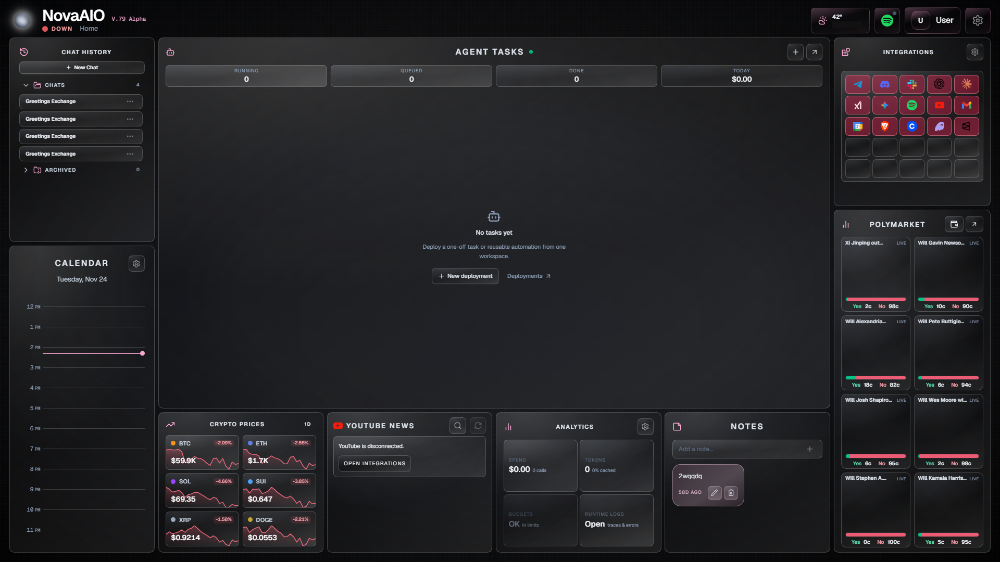
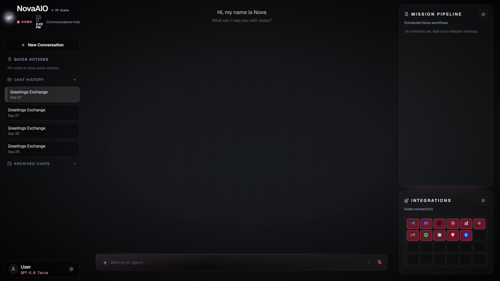
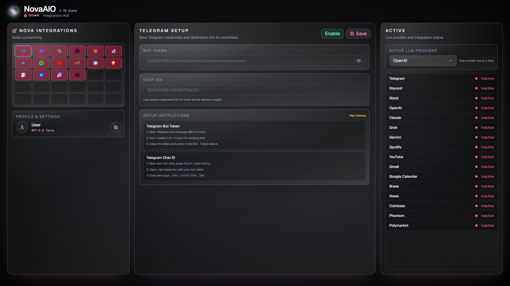

<p align="center">
  
</p>

<h1 align="center">Nova</h1>

<p align="center">
  <strong>A local-first LLM agentic framework platform: chat, agent runs, deployments, automations and integrations in one desktop app.</strong>
</p>

<p align="center">
  <!-- TODO: swap in a real hero screenshot or a short GIF of the home screen -->
  
</p>

<p align="center">
  Windows desktop app &nbsp;·&nbsp; Electron + Next.js 16 + React 19 &nbsp;·&nbsp; Node.js agent runtime &nbsp;·&nbsp; TypeScript
</p>

---

## Overview

Nova is a local-first LLM agentic framework platform that runs on your own machine. You talk to it by text or voice, and it can do real work: read your email, check your calendar, search the web, run scheduled automations, track crypto and prediction markets, and run long agent tasks in the background.

I built it to answer a simple question: what does an AI assistant look like when it isn't a chat box in a browser tab, but a proper desktop application with tools, memory, a scheduler, and guardrails? Everything is stored locally. API keys are encrypted at rest, and no account or hosted backend is required.

**Status:** Alpha (V.88). Actively developed and used daily by the author.

---

## Screenshots

<!-- TODO: add screenshots to docs/screenshots/ using the file names below -->

| Home | Chat |
| :---: | :---: |
|  |  |
| The command center: ask or deploy, live runs, deployments, and today's usage, integrations, schedule, notes and chats | Streaming chat with tool calls and approvals |

| Runs | Deployments |
| :---: | :---: |
|  |  |
| Every agent task and deployment run, with approvals, budgets and a detail sheet | Describe an outcome or build a task or automation; one lifecycle for both |

| Integrations | Voice |
| :---: | :---: |
|  |  |
| Connect Gmail, Calendar, Telegram, Discord, Spotify, and more | Wake-word activation and spoken replies |

---

## What It Can Do

### Conversational assistant
- Streaming chat with tool use, conversation history, and per-user context isolation.
- Works with **OpenAI, Anthropic (Claude), Gemini, and Grok**. Provider fallback and routing preference (balanced, latency, cost, quality) are configurable. Default models: `gpt-5.6-terra`, `claude-sonnet-5`, `gemini-3.8-flash`, `grok-4.3`.
- Persona files (`SOUL.md`, `IDENTITY.md`, `USER.md`, `MEMORY.md`) let you shape how the assistant talks and what it knows about you.

### Voice
- Wake-word activation. The wake word follows whatever name you give the assistant.
- Text-to-speech through Fish Audio with switchable voices.

### Deployments
- **Describe it** (`/deployments/new`) is a live Nova manager conversation: describe an outcome, review a validated task-or-automation plan, then launch it.
- **One-off task** and **Automation** tabs expose connected provider/model selection, permissions, context/files, worktrees, budgets, and the guided Mission builder or graph canvas.
- `/deployments` lists every deployment with its schedule, state and latest run; `/runs` shows every run with Approve / Deny / Cancel. Every launch has a canonical DeploymentRun, immutable definition revision, replayable event history, idempotency key, and cancellation/review controls.

### Automation workflows
- A visual canvas built on React Flow with 30+ node types across triggers, data, AI, logic, transforms, and outputs.
- Missions run as a dependency graph with parallel branches.
- A job ledger with idempotency keys and retry handling keeps scheduled runs from double-firing or getting lost.
- Deliver results to Telegram, Discord, Slack, or email.

### Background task execution
- Queue background tasks against Claude, OpenAI, Gemini, or Grok.
- Play, pause, stop, and delete controls on the **Runs** page. Up to 5 tasks run at once.
- Priority levels, permission modes (default, accept-edits, plan-mode, don't-ask, bypass), and live token and cost tracking per task.
- Per-task budgets, on cost by default ($2.00 per task; a token budget is optional). Defaults and a cheaper same-provider "economy model" per provider are set in **Settings → Agent budgets**. At 80% the run shows a warning; at 100% the task first trims older tool results and switches to the economy model, then pauses before a call that would go over, with **Resume / Raise budget / Abort** on the run.

### Usage analytics
- Every LLM call (chat, agent tasks, missions, utility calls, embeddings) is recorded in a local per-call ledger: provider, model, routing tier, input / output / cached tokens and cost.
- **Settings → Model routing**: small internal calls (format corrections, empty-reply recovery, Spotify parsing, mission classify / extract steps) can use the same provider's economy model when that is estimated to be cheaper (default: "Trivial calls only"). An opt-in cost-saving mode also routes ordinary chat; agent tasks and multi-step reasoning always keep your selected model.
- The **Analytics** page shows cost and tokens over time by source, provider, model and routing tier, cached vs uncached input with the estimated savings from caching, and per-task budget use. The Home **Usage** panel shows today's and the last 7 days' spend and tokens with the cached share, a daily cost strip, and a link to tasks at their budget limit.

### Memory
- Hybrid retrieval that combines keyword and embedding search.
- Query expansion, MMR re-ranking to cut near-duplicate results, and temporal decay so recent memories rank higher.
- Markdown-backed, so you can read and edit what the assistant remembers.

### Integrations
| Category | Services |
| --- | --- |
| Communication | Gmail, Telegram, Discord, Slack |
| Productivity | Google Calendar, Spotify, YouTube |
| Markets | Coinbase, Polymarket |
| Research | Brave web search, page fetch and summarize |
| Voice | Fish Audio TTS |

### Skills
Skills are plain `SKILL.md` files the assistant discovers at startup. Included: daily briefing, research, summarize, weather, Spotify, Coinbase, day-in-history, session logs, healthcheck, and handoff/pickup for continuing work across sessions. Adding one means adding a folder and a markdown file.

---

## Architecture

In development Nova runs as two cooperating processes, started together by a single launcher (`nova.js`). In the packaged desktop app, Electron's main process hosts both halves in-process: the Next.js production server (API routes included) on a loopback port and the agent runtime (`hud/electron/production-server.js`).

```
┌──────────────────────────┐        WebSocket         ┌──────────────────────────┐
│  HUD  (Next.js / React)  │ ◄──────────────────────► │  Agent Runtime (Node.js) │
│  localhost:3000          │      localhost:8765      │                          │
│                          │                          │  chat handler + routing  │
│  app shell · home · chat │                          │  tool loop + policies    │
│  runs · deployments      │                          │  memory · skills         │
│  missions · integrations │                          │  voice loop · scheduler  │
│  analytics · Electron    │                          │                          │
└──────────────────────────┘                          └──────────────────────────┘
             │                                                       │
             └──────────────► local storage (nova.db, SQLite) ◄──────┘
```

### The HUD

Every page lives in one app shell (`hud/components/shell/`): a collapsible sidebar, a top bar with breadcrumbs and the runtime connection status, and a **Ctrl+K** command palette for recent chats, pages, actions and Settings sections (Ctrl+B or `[` toggles the sidebar, Ctrl+, opens Settings). The UI is built from one design system: tokens in `hud/app/styles/theme.css` and primitives in `hud/components/ui/` (see [docs/frontend/design-system.md](docs/frontend/design-system.md); every primitive renders at `/dev/design`).

| Page | What it does |
| --- | --- |
| `/home` | Command center: ask or deploy, live work, deployments and the next scheduled run, plus today's usage, integrations, schedule, notes and recent chats. All of it is real data. |
| `/chat` | Streaming chat with tool calls, approvals and conversation history |
| `/runs` | Every agent task and deployment run: what waits for your approval, budget state, row actions, a detail sheet |
| `/deployments`, `/deployments/new` | Deployment list with schedules and latest runs; the New deployment flow (`?tab=describe\|task\|automation`) |
| `/missions`, `/missions/calendar` | Automation definitions, the graph builder and canvas, and a calendar of scheduled runs and Google Calendar events |
| `/integrations` | Master-detail setup for every integration (`?setup=<key>&tab=setup\|settings\|live\|instructions`) |
| `/analytics`, `/history`, `/polymarket`, `/dev-logs` | Cost and token ledger, past chats, prediction markets (when Polymarket is connected), runtime traces and errors |

Settings is one dialog with Profile, Personalization, Appearance, Audio & voice, Notifications, Agent budgets, Model routing, Skills and Local data. Old links (`/home?room=...`, `/deployments?mode=...`) redirect to these pages (`hud/next.config.js`).

| Path | What lives there |
| --- | --- |
| `hud/` | Next.js app (App Router), React components, API routes, Electron shell |
| `src/runtime/` | Agent runtime: chat handler, request scheduler, voice and wake-word loops |
| `src/tools/` | Tool system, split into `core/` (policy, registry, executor), `builtin/`, and `web/` |
| `src/memory/` | Embeddings, hybrid search, chunking, MMR, temporal decay |
| `src/providers/` | LLM provider clients and runtime |
| `src/skills/` + `skills/` | Skill discovery and the bundled skills |
| `hud/lib/deployments/` | Canonical deployment definitions, runs, events, and compatibility projection |
| `hud/lib/missions/` | Automation graph types, DAG executor, job ledger, scheduler |
| `scripts/smoke/` | Smoke and regression tests, grouped by area |

### Engineering decisions worth calling out

- **Bounded tool loops.** Every chat and agent tool loop has limits on step count, total duration, per-call timeout, and calls per step, all configurable. A runaway model can't spin forever.
- **Prompt caching.** The system prompt is split into a static part (identity, policies, persona files, runtime) that stays byte-identical across turns and a per-turn part after it, so providers can bill the repeated prefix at their cached rate. Claude requests carry `cache_control` breakpoints on the static system block and, in tool loops, on the latest message. The model is only offered Gmail / Coinbase / Phantom tools when that integration is connected, in a fixed order, so the tool list is stable too.
- **Bounded tool output.** Every tool result passes one output-cap registry (`src/tools/core/output-caps`) before it reaches the model; a cut result ends with a marker that says how much was cut and how to get the rest (`read` returns a 400-line window).
- **Capability and risk policies.** Tools are gated by policy before they execute, and higher-risk actions can require approval from the HUD.
- **Network safety.** Web fetch goes through an SSRF guard that blocks requests to private and internal addresses.
- **Secrets handling.** Stored API keys are encrypted at rest (AES-256-GCM) with a random master key that Windows DPAPI wraps for your Windows account; secrets are never returned unmasked to the browser. See [docs/security/local-data.md](docs/security/local-data.md) for what this does and does not protect against. OAuth flows use signed state, comparisons are timing-safe, and API routes are rate limited per user and per IP.
- **Per-user isolation.** Runtime state, memory, and sessions are scoped by user, and there are tests that check the boundaries.
- **Reliable scheduling.** Missions are enqueued with idempotency keys and claimed with leases, so the scheduler can restart without duplicating runs.

---

## Tech Stack

| Layer | Tools |
| --- | --- |
| Frontend | Next.js 16, React 19, TypeScript, Tailwind CSS 4, Nova design system (`hud/components/ui`), Radix UI, React Flow, Recharts, Lucide icons, Geist |
| Desktop | Electron, electron-builder (Windows NSIS installer) |
| Runtime | Node.js 22+, WebSockets, Vercel AI SDK |
| Storage | SQLite (`better-sqlite3`, one local `nova.db`), DPAPI-protected encrypted secrets, markdown workspace docs as files |
| Validation | Zod |
| Testing | Playwright, custom Node smoke suites, `tsc` and ESLint |

---

## Getting Started

### Prerequisites
- Windows 10 or 11 (the launcher and installer target Windows)
- Node.js 22 or newer
- An API key for at least one LLM provider (OpenAI or Anthropic to start)

### Install

```bash
git clone https://github.com/AverageNftEnjoyer/Nova.git
cd Nova

npm install
npm run install:all      # installs the HUD dependencies
```

### Configure

```bash
copy .env.example .env
```

At minimum, set an LLM key:

```env
OPENAI_API_KEY=...        # and/or ANTHROPIC_API_KEY
```

There is no encryption key to configure. Nova generates a random master key on first run and protects it with Windows DPAPI (current Windows user); API keys you enter in the app are encrypted with it before they are written to the local database. See [docs/security/local-data.md](docs/security/local-data.md) for details and limits.

Integrations (Gmail, Telegram, Discord, Spotify, and so on) are optional and can be set up from the in-app Integrations page (`/integrations`, or `/integrations?setup=<key>` to open one).

The per-call usage ledger keeps 90 days by default; set `NOVA_LLM_USAGE_RETENTION_DAYS` (1–3650) to change it. The per-turn prompt sections (skills, preferences, memory recall, web and link context) have their own budget, `NOVA_PROMPT_TURN_CONTEXT_MAX_TOKENS` (default 5,000); `NOVA_MAX_PROMPT_TOKENS` (default 18,000) sizes the history budget.

### Run

```bash
npm run dev      # development: launches the agent runtime and the HUD together
npm start        # production build of the HUD
```

Then open `http://localhost:3000`.

### Build the desktop app

```bash
cd hud
npm run electron:build:win
```

This builds the HUD with `npm run build:package` (a Next.js build that also writes Next's output-file trace), stages the agent runtime (`src/`, `dist/`, production-only runtime `node_modules`) with `electron:prepare-runtime`, and runs electron-builder. The packaged Next.js install is pruned to exactly the files that trace lists, and build-only files (typings, source maps, tests, docs) are left out. The installer is about 124 MB and is written to `hud/dist/`; `npm run package:size` (in `hud/`) shows where the megabytes go. The packaged app keeps its data in `%APPDATA%\Nova`, never in the install directory. Installed builds update themselves from GitHub Releases (see [docs/release/auto-update.md](docs/release/auto-update.md)). Closing the window (X) quits Nova; minimizing sends it to the taskbar and it keeps running.

To check a packaged build boots without clicking through the installer (from the repo root):

```bash
npm run smoke:production-boot     # boots hud/dist/win-unpacked in Node and claims a queued agent task
npm run smoke:production-routes   # loads every page and GET API route of the packaged build
```

---

## Testing

The project leans on smoke tests that exercise real code paths instead of mocks. One command covers the functional gate:

```bash
npm run smoke:fundamental
```

That runs the Node tests and type checks, the runtime smoke, local SQLite (including deployment migrations), encryption, local API and runtime security, tools, routing core, agent tasks, the token regression gate, and the Playwright product flows in `hud/tests/smoke/`.

```bash
npm run typecheck         # agent + HUD type checks
npm run lint              # ESLint for agent and HUD
npm run smoke:src-release # fuller release chain (scheduler, delivery, Coinbase CI, isolation closure, HUD build)
```

Per-change smokes (a separate script for each integration lane, audit finding, or workstream) are not part of the suite. The catalog of what remains is [scripts/smoke/README.md](scripts/smoke/README.md).

---
